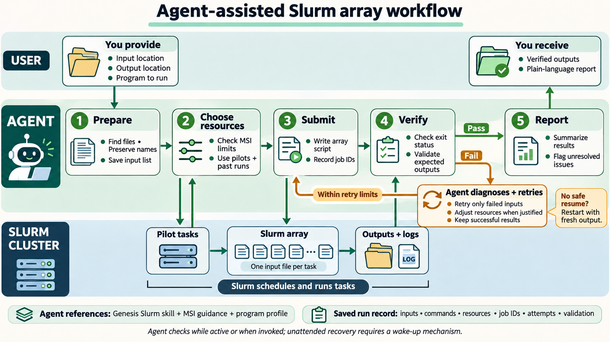

# Agent-assisted Slurm array job management

This project explores how an agent can manage many independent file-processing jobs through Slurm arrays. A user supplies the input location, output location, and intended program or analysis. The agent turns that request into a reproducible run: prepare inputs, select resources, submit arrays, check results, recover eligible failures, and report the outcome.

The agent manages the workflow through ordinary Slurm commands. Slurm schedules and executes the jobs; the program performs the analysis. Completion requires both successful execution and program-specific output validation.

## Roles and responsibilities

- **Understand the requested work.** Establish how the program accepts one input and writes its outputs, which options and environment it requires, and what demonstrates a correct result. Ask focused questions when missing information prevents a reliable decision.
- **Learn the cluster.** Verify access, submission accounts, partitions, software setup, and current limits using site documentation and scheduler information. Maintain reusable cluster and program profiles.
- **Set operating limits.** Establish authorized ceilings for CPUs, memory, GPUs, runtime, simultaneous tasks, and retries. Proceed within those limits without repeatedly asking for confirmation.
- **Prepare a reproducible run.** Check input readability and output writability, select the intended files, and create a dedicated run record. Freeze the task-to-input mapping, preserve filenames, assign distinct output destinations, and record enough input identity information to detect changes.
- **Choose suitable resources.** Request resources the program can use. Estimate memory and runtime from comparable successful runs or representative pilots, inspect measured usage, and group substantially different workloads when useful. Count validated pilot outputs as completed work.
- **Submit safely.** Generate scripts with explicit environment setup, resource requests, task selection, and separate logs and temporary outputs for each attempt. Record submission intent before submitting, save returned job IDs, reconcile uncertain submissions, and prevent overlapping attempts for the same input.
- **Track progress.** Check current jobs and completed-job accounting. Distinguish waiting, running, verifying, successful, retrying, and needs-attention states. Investigate uncertain outcomes before deciding whether to retry.
- **Validate and publish outputs.** Require a successful program exit and meaningful checks of the current attempt's outputs. Publish only validated results, verify publication, and record which input and outputs completed successfully.
- **Recover selectively.** Diagnose stopped failures from scheduler data, program logs, and validation results. Preserve verified successes and retry only eligible unresolved inputs within the attempt limit. Adjust resources within authorized ceilings when evidence supports it; resolve invalid inputs, command errors, or missing software before retrying.
- **Use demonstrated recovery methods.** Start retries with fresh output unless safe restart behavior has been established. Treat validated files or independent stages as recovery points; resuming a program's internal state requires actual checkpoint support.
- **Preserve evidence and resume reliably.** Retain manifests, exact commands, environment details, scripts, resource decisions, submission records, job IDs, attempt logs, validation results, measurements, and retry reasons. Reconcile these records with Slurm and stored outputs before resuming.
- **Report clearly.** Describe progress using filenames and plain language. At completion, state how many inputs succeeded, how many recovered after retry, and what remains unresolved. Identify unavailable resource measurements honestly.

The user defines the intended analysis and authorizes the scope and operating limits. Actions outside those limits require further authorization. Progress checks occur while the agent is active or when invoked; unattended monitoring requires an explicitly configured mechanism to wake the agent.

## Typical workflow

1. Inspect the program, inputs, cluster requirements, and authorized limits.
2. Save the run configuration and frozen input manifest.
3. Run representative pilots when resource evidence is insufficient.
4. Validate pilot results and choose resource requests for the remaining work.
5. Submit bounded arrays and track jobs through Slurm.
6. Validate outputs and preserve successes.
7. Diagnose stopped failures and retry eligible inputs within limits.
8. Produce a final report with per-input outcomes and supporting evidence.

## Completed test

The [six-input text-file test](test-20261112T221451Z/README.md) demonstrates this workflow on MSI's `agate` cluster. It includes a filename containing spaces, a deliberate partial-output failure, and deliberately incomplete output from a program that exits successfully. All six final outputs passed exact comparison; two inputs recovered after one retry each.

The test folder contains its step-by-step summary, scripts, inputs, expected and final outputs, failed-attempt evidence, logs, resource profiles, and [final accounting report](test-20261112T221451Z/REPORT.md). These are archived artifacts from that run; applying the workflow to another program requires its own environment, validation rules, resource estimates, and recovery method.
